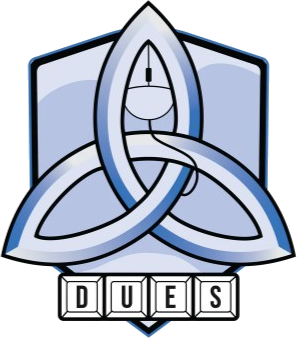

<p align="center"></p>

<h1 align="center">DUES Inhouses</h1>

<p align="center">
  Leaderboards, match history, player profiles and team builders for the<br>
  <b>Dublin University Esports Society</b>'s Overwatch and Valorant inhouses,<br>
  with a Discord bot that runs the Saturday Valorant weeklies.
</p>

<p align="center">
  <a href="#what-it-does"><b>Features</b></a> ·
  <a href="#getting-started"><b>Getting started</b></a> ·
  <a href="docs/setup.md"><b>Setup guide</b></a> ·
  <a href="docs/setup.md#running-a-night"><b>Running a night</b></a> ·
  <a href="docs/setup.md#configuration"><b>Configuration</b></a> ·
  <a href="#credits"><b>Credits</b></a>
</p>

<h3 align="center">Created and maintained by</h3>

<table align="center">
  <tr>
    <td align="center" width="200">
      <a href="https://github.com/Basicallyanoob">
        <br>
        <b>Basicallyanoob</b>
      </a><br>
      <a href="https://github.com/Basicallyanoob"><sub>@Basicallyanoob</sub></a><br>
      <sub>Creator &amp; maintainer</sub>
    </td>
    <td align="center" width="200">
      <a href="https://github.com/SebastianBuryy">
        <br>
        <b>Sebastian Bury</b>
      </a><br>
      <a href="https://github.com/SebastianBuryy"><sub>@SebastianBuryy</sub></a><br>
      <sub>Co-creator &amp; maintainer</sub>
    </td>
  </tr>
</table>

---

## What it does

- **Leaderboards for both games.** Overwatch and Valorant each get a ladder, every match with full scoreboards, records, hero or agent stats, and a team builder. Leaderboards can show everyone or only DUES members.
- **Fair ratings.** Everyone starts at 1,000. Only inhouse results move it, scaled by round margin and individual performance ([details](docs/setup.md#how-ratings-work)).
- **Player profiles.** One per member across both games, with a rating chart, levels, favourite heroes or agents, best teammates and every game played.
- **Games come in automatically.** Valorant customs are picked up through the [HenrikDev API](https://docs.henrikdev.xyz). Overwatch nights are uploaded from ScrimTime Workshop logs in one go.
- **Weeklies run themselves in Discord.** Members sign up with a button, the bot balances the teams on rank and rating, the lobby votes on the map, and the results are posted with everyone's rating change.
- **Light and dark themes**, with a switch in the top bar.

## Built with

[Next.js](https://nextjs.org) and React on [Vercel](https://vercel.com) · Postgres on [Supabase](https://supabase.com) · Discord sign-in and bot · GitHub Actions for the Saturday schedule · [Vitest](https://vitest.dev)

All of it runs on free plans.

## Getting started

```bash
cd dues-inhouse
npm install
cp .env.example .env.local      # fill in DATABASE_URL, and DEV_LOGIN=1 for local sign-in
npm run db:seed-demo            # an invented demo season to look at
npm run dev                     # http://localhost:3000
npm test
```

### 📖 [Read the full setup guide →](docs/setup.md)

Deploying to Vercel and Supabase, setting up the Discord bot and schedule, running a weekly night, and every setting.

## Credits

[Blueward](https://github.com/Kickblip/blueward) for the idea · [ScrimTime](https://workshop.codes/FYHQV) by Caldoran for Overwatch logs · [HenrikDev API](https://docs.henrikdev.xyz) for Valorant data · [openskill.js](https://github.com/philihp/openskill.js) for ratings · Inter font by Rasmus Andersson ([OFL](dues-inhouse/public/fonts/OFL-Inter.txt)). The DUES crest belongs to the Dublin University Esports Society.

<sub>Overwatch is a trademark of Blizzard Entertainment. This site isn't endorsed by Riot Games and doesn't reflect the views or opinions of Riot Games or anyone officially involved in producing or managing Riot Games properties. Riot Games, Valorant and all associated properties are trademarks or registered trademarks of Riot Games, Inc. Neither company is affiliated with this site.</sub>
