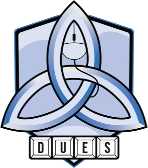

<p align="center"></p>

# DUES Inhouses

Leaderboards, records, player profiles and team builders for the Dublin University Esports Society's **Overwatch** and **Valorant** inhouses, with a club currency (**Crests**) and a banner collection members roll for in the shop.

It grew out of the static Overtime site and follows [Blueward](https://github.com/Kickblip/blueward), the League of Legends club tracker, feature for feature where it fits. It's written from scratch: Blueward has no licence, so none of its code or art is used.

## What it does

- **Two games, one site.** A switch at the top moves between Overwatch and Valorant. Each has a ladder, every match with full scoreboards, single-game records, hero or agent stats, and a team builder.
- **Ratings.** Openskill (Plackett-Luce), the same model and numbers as the Overtime site: an overall rating per game, plus tank, damage and support ratings in Overwatch. Only results count.
- **Profiles.** One per member across both games: equipped banner, Discord picture, level, a 75-character note, rating chart, heroes or agents, best teammates and every game.
- **Getting games in.**
  - *Overwatch:* hosts play with the ScrimTime Workshop mode; an officer drops the night's log files (or a zip) on **Admin > Games**.
  - *Valorant:* automatic. Every member's linked Riot ID is an anchor: the site reads each anchor's recent games from the unofficial [HenrikDev API](https://docs.henrikdev.xyz) and keeps finished custom games with 10 players, at least 3 of them members. It runs twice a day; officers press **Fetch now** after a night. A scoreboard can also be typed into a CSV when the API is down.
- **Accounts.** Members sign in with Discord, then ask to link their BattleTag and Riot ID. An officer approves each link, which joins every past and future game on that account to them and pays them for it. Roster entries for people who haven't signed in yet merge into them when they claim the account. A Riot name change doesn't split a profile: the site follows the account.
- **Crests.** 600 per finished game (+200 for a win), 1,000 for the daily reward, and promo codes. They have no money value and can't be bought or traded.
- **Banners.** Roll on a set for 1,000 (or 10 at once): common 56%, rare 30%, epic 11%, legendary 2.5%, ultimate 0.5%, with a legendary-or-better guarantee by the 60th roll. Duplicates refund 30 to 100% of the roll. Officers can make some banners buyable outright, run limited sets with their own dates and rates, and upload the art (pictures or short videos). Until art is uploaded, banners show a placeholder in their rarity's colour.
- **Admin.** Approve account links, upload games, fetch Valorant, remove games (their Crests are taken back), add roster members or import the old Overtime roster, adjust Crests, set roles, manage banners, sets and promo codes.

What's still to come (stages 2 and 3): live rooms with captain drafts, predictions on games, and events such as a climb challenge.

## How it's built

Next.js 16 on **Vercel**, with **Supabase** for the database (Postgres), Discord sign-in and banner image storage. Both have free plans that cover a society this size: Supabase's free plan gives a 500 MB database and 1 GB of storage, and pauses a project after a week with no activity, which the twice-daily Valorant check should prevent.

```
app/                 pages and server actions (admin/, overwatch/, valorant/, players/, shop/, me/)
app/api/             JSON endpoints: rolls, daily reward, uploads, Valorant fetch, cron
lib/ow/parse.ts      ScrimTime log parser
lib/val/             HenrikDev API import, Valorant match format, typed-in scoreboards
lib/season.ts        everything the stats pages show, rebuilt when games change
lib/ratings.ts       openskill ratings (checked against the Python site's numbers in tests)
lib/shop.ts          Crests, daily reward, rolls, pity, duplicates, buying, promo codes
lib/members.ts       account links, approvals, roster merges, roles
lib/economy.ts       every amount and price, in one place
config/              heroes.yaml (hero roles), agents.yaml (agent classes)
supabase/            schema.sql and seed.sql for the database
public/              team builder scripts, fonts, crest
tests/               vitest: parsing, ratings, shop rules, linking, Valorant import, builders
```

## Setting up

You need free accounts on GitHub, [Supabase](https://supabase.com), [Vercel](https://vercel.com) and the [Discord Developer Portal](https://discord.com/developers/applications). Allow about 30 minutes.

### 1. Database (Supabase)

1. Create a project. Pick the **West EU (Ireland)** region and save the database password somewhere safe.
2. Open **SQL Editor > New query**, paste all of `supabase/schema.sql`, and press **Run**. Then do the same with `supabase/seed.sql`, which adds the starter banner set.

### 2. Discord sign-in

1. In the Discord Developer Portal, **New Application**, named e.g. "DUES Inhouses". Under **OAuth2**, copy the **Client ID** and reset and copy the **Client Secret**.
2. In Supabase, **Authentication > Sign In / Providers > Discord**: turn it on and paste the ID and secret. Copy the **Callback URL** it shows (it ends in `/auth/v1/callback`).
3. Back in Discord, **OAuth2 > Redirects > Add Redirect**, and paste that callback URL. Save.
4. In Supabase, still under **Sign In / Providers**, **turn off Email** (and anonymous sign-ins if on). The site only uses Discord, and leaving email sign-up on lets people create accounts that aren't tied to Discord.

### 3. The site (Vercel)

1. Push this folder to a new GitHub repository.
2. In Vercel, **Add New > Project**, import the repository, and before deploying open **Environment Variables** and add:

   | Name | Where to find it |
   | --- | --- |
   | `DATABASE_URL` | Supabase **Connect** (top bar) > **Transaction pooler** connection string (port 6543), with your database password filled in |
   | `NEXT_PUBLIC_SUPABASE_URL` | Supabase **Project Settings > Data API**: Project URL |
   | `NEXT_PUBLIC_SUPABASE_ANON_KEY` | Supabase **Project Settings > API Keys**: the publishable (anon) key |
   | `SUPABASE_SERVICE_ROLE_KEY` | Same page: the secret (service_role) key. Server-only, for banner art uploads. Never share it |
   | `ADMIN_DISCORD_IDS` | Your Discord user id (Discord settings > Advanced > Developer Mode on, then right-click your name > Copy User ID). Several ids can be separated by commas |
   | `HENRIKDEV_API_KEY` | Your HenrikDev key (`HDEV-...`) |
   | `CRON_SECRET` | Any long random text; Vercel sends it to the twice-daily Valorant check |

3. Deploy. Copy the site's address (e.g. `https://dues-inhouse.vercel.app`).
4. In Supabase, **Authentication > URL Configuration**: set **Site URL** to that address, and add `https://<your address>/auth/callback` under **Redirect URLs**.
5. Open the site and **Sign in with Discord**. Because your id is in `ADMIN_DISCORD_IDS`, you're an admin. Make other committee members officers on **Admin > Members** once they've signed in.

### 4. Bring over the Overtime data

1. **Admin > Members > Import the old roster**: upload the Overtime `config/players.csv`. Everyone on it becomes a roster entry with their accounts linked, and merges into them when they sign in.
2. **Admin > Games > Upload games**: zip the Overtime `logs/` and `valorant/` folders and drop the zip in. Files already imported are skipped, so it's safe to repeat.

## Running a night

- **Overwatch:** the host saves logs as before (ScrimTime with Log Generator and Player Stat Summary on, and *Enable Workshop Inspector Log File* in Overwatch's settings). Afterwards an officer uploads the night's files from `Documents/Overwatch/Workshop` on **Admin > Games**.
- **Valorant:** play with at least 3 linked members in the lobby. Afterwards, an officer presses **Fetch now** on **Admin > Games**, or the site picks the games up by itself within 12 hours.
- **Team builders** on each game's **Team builder** page split the ten players in the lobby into the most even teams.

## Changing things

- **Amounts and prices:** `lib/economy.ts` (Crests per game, daily reward, banner prices, duplicate refunds, level curve). Roll cost, rates and pity are per set, on **Admin > Banners**.
- **New heroes or agents:** add them to `config/heroes.yaml` or `config/agents.yaml`. The leaderboards say when one is missing.
- **Other settings** (Vercel environment variables, all optional): `MIN_GAMES_RANKED` (games before someone appears on a ladder, default 5), `VAL_MIN_PLAYERS` (default 10), `VAL_MIN_MEMBERS` (default 3), `VAL_REGION` (default `eu`), `CLUB_TIME_ZONE` (default `Europe/Dublin`).
- **Banner art:** a wide picture, about 4:1 (1600 × 400 works well), PNG, JPEG or WebP, or a short WebM or MP4 for an animated banner, up to 4 MB.

## Running it on your computer

Needs Node 20 or newer and PostgreSQL 15 or newer.

```
npm install
npm run db:local                       # starts Postgres in .data/ and loads the schema
cp .env.example .env.local             # then set DATABASE_URL to what db:local printed, and DEV_LOGIN=1
DATABASE_URL=postgres://postgres@localhost:5433/dues npm run db:seed-demo   # invented demo season
npm run dev                            # http://localhost:3000
npm test                               # uses a separate dues_test database
```

With `DEV_LOGIN=1`, the sign-in page lets you act as any player without Discord. It never works in production.

## Limitations

- Valorant games are only found if a linked member was in the lobby, and while the game is still among that member's last 10. With the twice-daily check and **Fetch now**, that's rarely a problem.
- The HenrikDev API is unofficial and run by one person. If it changes or stops, typed-in scoreboards still work.
- Riot leaves its per-player performance score empty for custom games, so the site doesn't show one.
- Ratings from one term are noisy; treat small gaps as ties.
- The site is public. Members should know their in-game names and stats appear on it.

## Credits

- [Blueward](https://github.com/Kickblip/blueward) by Longhorn LoL, for the idea and the feature set.
- [ScrimTime](https://workshop.codes/FYHQV) by Caldoran writes the Overwatch logs.
- [HenrikDev API](https://docs.henrikdev.xyz) for Valorant match history.
- [openskill.js](https://github.com/philihp/openskill.js) for the rating model.
- Barlow and Barlow Condensed by Jeremy Tribby, under the SIL Open Font License (`public/fonts/OFL-Barlow.txt`).
- The DUES crest belongs to the Dublin University Esports Society.

Overwatch is a trademark of Blizzard Entertainment. This site isn't endorsed by Riot Games and doesn't reflect the views or opinions of Riot Games or anyone officially involved in producing or managing Riot Games properties. Riot Games, Valorant and all associated properties are trademarks or registered trademarks of Riot Games, Inc. Neither company is affiliated with this site.
